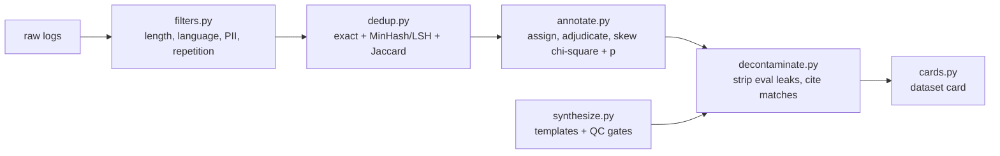

# Jagadish-dataset-engineering

[](https://github.com/jagadishmazure-jpg/Jagadish-dataset-engineering/actions/workflows/ci.yml)
[](https://github.com/jagadishmazure-jpg/Jagadish-dataset-engineering/actions/workflows/codeql.yml)


**The data layer under SFT and evals, as code you can test: heuristic filters, MinHash/LSH dedup, annotation with adjudication and labeler-skew detection, eval decontamination, QC-gated synthetic data, and dataset cards. Synthetic data, offline.**

> Personal learning and portfolio project. Everything runs offline on synthetic,
> fictional data with no API keys. Nothing is deployed. Numbers in this README
> come from real runs and are re-checked by CI (`scripts/render_docs.py --check`).

## Recruiter summary

- Covers the steps that set the ceiling on model quality before any training: what gets filtered, deduplicated, labelled, removed for eval leakage, synthesised and documented.
- Real run: 8 logs, 5 kept (PII, repetition and length rejections named); 1 duplicate group; an always-positive labeler flagged (chi-square 28.5, p < 0.0001); 1 eval leak removed; 10 synthetic items accepted, 9 rejected with reasons; a dataset card rendered.
- Review fixes: skew reports now include degrees of freedom and a p-value, and the demo shows two known misses: a paraphrase the default dedup threshold lets through, and a labeler with p = 0.009 that the fixed chi-square threshold does not flag.

## Purpose

Model choice gets the attention, but data pipelines decide the ceiling: a
skewed labeler, paraphrased duplicates, eval items leaking into training, or
narrow synthetic data each cap quality without any error message. I built each
step small enough to read and test, so the guarantees are written down as
tests rather than claimed. It is for engineers preparing SFT or eval data who
want each step to be auditable.

## Architecture



## How it works

**Filter** (`dataeng/filters.py`): length bounds, an English-ratio stub, PII
patterns (email, phone, SSN, card) and a repetition check. Every rejection
names the checks it failed.

**Dedup** (`dataeng/dedup.py`): an exact fast path on normalised text, then
word 5-shingle MinHash (64 seeded md5 permutations, 16 LSH bands). Candidates
are confirmed by exact Jaccard.

**Annotate** (`dataeng/annotate.py`): round-robin assignment with overlap,
labels that cite `(task_id, labeler_id)`, and majority vote with ties sent to
expert review. Skew detection compares each labeler's label counts with the
pooled counts of the other labelers (chi-square, Laplace smoothing). It
reports the statistic, degrees of freedom and a p-value computed in pure
Python.

**Decontaminate** (`dataeng/decontaminate.py`): train items that match an eval
item exactly or nearly are removed, and each removal cites the eval id, score
and kind.

**Synthesize and card** (`dataeng/synthesize.py`, `dataeng/cards.py`):
template generation behind schema, length, dedup and template-share gates,
with every rejection logged. A markdown dataset card is rendered from the run
manifest.

## Real code and output

```python
"""SFT data pipeline on synthetic support logs: filter, dedup, annotate with skew check, decontaminate, synthesize, card."""
from dataeng import (
    AnnotationPipeline,
    ConversationFilter,
    Deduplicator,
    SyntheticGenerator,
    build_dataset_card,
    decontaminate,
)

logs = [
    ("m1", "My parcel arrived with a cracked lid, how do I get a replacement sent out?"),
    ("m2", "my parcel arrived with a cracked lid, how do I get a replacement sent out?"),
    ("m3", "My parcel arrived with a cracked lid, how can I get a replacement sent out to me?"),
    ("m4", "Please email me at ana.lopez@example.com about the invoice for last month"),
    ("m5", "ok ok ok ok ok ok ok ok ok ok ok ok ok ok ok ok ok ok ok ok"),
    ("m6", "hi"),
    ("m7", "Can I change the delivery address after the order has already shipped?"),
    ("m8", "What is the warranty period on the blender I bought in March?"),
]
kept, rejected = ConversationFilter().filter_batch(logs)
print(f"Filter: kept {len(kept)}/{len(logs)}; rejected " + ", ".join(f"{i} ({'+'.join(r.failed)})" for i, r in rejected))

text = dict(logs)
dedup = Deduplicator()
for i in kept:
    dedup.add(i, text[i])
groups = dedup.find_duplicates()
print(f"Dedup: duplicate groups {groups}")
unique = [i for i in kept if not any(i in g[1:] for g in groups)]

pipe = AnnotationPipeline(["ann-a", "ann-b", "ann-c"], overlap=3)
for n in range(12):
    pipe.add_task(f"t{n}", f"rate reply {n}", ["helpful", "neutral", "unhelpful"])
pipe.assign()
for n in range(12):
    honest = ["helpful", "neutral", "unhelpful"][n % 3]
    pipe.submit_label(f"t{n}", "ann-a", honest)
    pipe.submit_label(f"t{n}", "ann-b", honest if n % 4 else "neutral")
    pipe.submit_label(f"t{n}", "ann-c", "helpful")  # always-positive labeler
for r in pipe.detect_skew():
    print(f"Skew: {r['labeler_id']} chi2 {r['chi2']:.2f} (df {r['df']}, p {r['p_value']:.4f}) "
          f"-> {'FLAGGED' if r['flagged'] else 'ok'}")
status = [a.status for a in pipe.adjudicate().values()]
print(f"Adjudication: {status.count('resolved')} resolved, {status.count('tie')} ties for expert review")

eval_items = [("ev1", "Can I change the delivery address after the order has already shipped?")]
report = decontaminate([(i, text[i]) for i in unique], eval_items)
print(f"Decontamination: {report.summary}; removed {[(r['train_id'], r['kind']) for r in report.removed]}")

gen = SyntheticGenerator(
    templates=["How do I {action} my {item} order from last {period}?", "Is {item} covered if it {problem}?",
               "{action} {item}"],
    pools={"action": ["return", "exchange", "track"], "item": ["kettle", "blender", "toaster"],
           "period": ["week", "month"], "problem": ["stops working", "arrives damaged"]},
    seed=7,
)
items, rejections = gen.generate(10)
reasons = sorted({r for rej in rejections for r in rej.reasons})
print(f"Synthetic: {len(items)} accepted, {len(rejections)} rejected; reasons {reasons}")

card = build_dataset_card({
    "name": "support-sft-demo", "version": "0.1.0", "source": "synthetic support logs (this script)",
    "pipeline_steps": [{"name": s, "version": "0.1.0"} for s in ("filter", "dedup", "annotate", "decontaminate")],
    "stats": {"n_items": len(unique) - report.summary["n_removed"] + len(items)},
    "license": "MIT",
})
print("Card: " + " | ".join(line for line in card.splitlines() if line.startswith("#")))
```

Output of `python examples/demo.py` (real run, re-checked in CI):

<!-- run: python examples/demo.py -->
```text
Filter: kept 5/8; rejected m4 (pii), m5 (language+repetition), m6 (length+language)
Dedup: duplicate groups [['m1', 'm2']]
Skew: ann-a chi2 4.39 (df 2, p 0.1112) -> ok
Skew: ann-b chi2 9.44 (df 2, p 0.0089) -> ok
Skew: ann-c chi2 28.50 (df 2, p 0.0000) -> FLAGGED
Adjudication: 11 resolved, 1 ties for expert review
Decontamination: {'n_train': 4, 'n_eval': 1, 'n_removed': 1, 'n_clean': 3, 'by_kind': {'exact': 1}}; removed [('m7', 'exact')]
Synthetic: 10 accepted, 9 rejected; reasons ['dedup: exact duplicate of existing data', 'diversity: template would exceed 0.5 share (>5 of 10)', 'length: 13 chars < minimum 30', 'length: 14 chars < minimum 30']
Card: # Dataset Card: support-sft-demo | ## Pipeline | ## Statistics | ## Known limitations | ## Intended use
```
<!-- /run -->

## How to run

```bash
git clone https://github.com/jagadishmazure-jpg/Jagadish-dataset-engineering.git
cd Jagadish-dataset-engineering
python -m pip install pytest      # no runtime dependencies
python -m pytest -q          # offline, no keys
python examples/demo.py
python scripts/render_docs.py --check   # documented output still matches
```

Test suite size (real collection, re-checked in CI):

<!-- run: python scripts/count_tests.py -->
```text
45 tests collected
```
<!-- /run -->

## Guardrails

- PII patterns reject a log before it can reach a dataset.
- Every filter, dedup, decontamination and synthesis decision is reported with its reason or score.
- Ties in adjudication go to expert review instead of being broken arbitrarily.
- Eval decontamination runs before the card is written, and the card records the pipeline steps and versions.

## Limitations

- The skew flag uses a fixed chi-square threshold (10.0); the demo's second labeler has p = 0.009 and is not flagged. The p-value is reported so the threshold can be set per label set.
- Dedup at the default Jaccard threshold of 0.5 misses the demo's reworded duplicate (m3); paraphrase detection needs embeddings.
- The language check is a stub based on common English words.
- PII detection is regex only; the card pattern has no Luhn check.
- All data is synthetic and small; the numbers show the logic, not production rates.

## Built vs planned

| Capability | Status | Where |
|---|---|---|
| Heuristic filters with named rejections | Built | `dataeng/filters.py` |
| Exact + MinHash/LSH dedup | Built | `dataeng/dedup.py` |
| Annotation, adjudication, skew with p-value | Built | `dataeng/annotate.py` |
| Eval decontamination with citations | Built | `dataeng/decontaminate.py` |
| QC-gated synthetic generation | Built | `dataeng/synthesize.py` |
| Dataset cards | Built | `dataeng/cards.py` |
| Embedding-based paraphrase dedup | Planned | docs/implementation-guide.md |
| Distributed shingling for large corpora | Planned | docs/implementation-guide.md |

## Threat model

| Threat | Mitigation in this repo | Status |
|---|---|---|
| PII enters a training set | Regex PII filter before dedup and annotation | Built |
| Eval leakage inflates scores | Decontamination with cited matches | Built |
| A biased labeler skews gold labels | Skew detection with p-value, adjudication ties to experts | Built |
| Synthetic data collapses diversity | Template-share cap, dedup gate, logged rejections | Built |
| Paraphrased duplicates slip through | Embedding dedup | Planned |

## Interview points

- Data quality caps model quality; I made each step testable so the guarantees are in tests, not in a slide.
- A fixed chi-square threshold ignores degrees of freedom; I report the p-value, and the demo shows a labeler the threshold misses.
- My dedup misses a reworded duplicate at the default threshold; I keep that visible instead of tuning it away.

More, with likely follow-up questions: [docs/interview-points.md](docs/interview-points.md).

## Implementation guide

The step-by-step path from this offline build to an Azure deployment is in
[docs/implementation-guide.md](docs/implementation-guide.md). None of it has been
run; it is a plan.

## Related repositories

| Repo | How it relates |
|---|---|
| [Jagadish-agent-feedback-loop](https://github.com/jagadishmazure-jpg/Jagadish-agent-feedback-loop) | Production corrections become new annotation tasks here |
| [Jagadish-data-lakehouse](https://github.com/jagadishmazure-jpg/Jagadish-data-lakehouse) | Decontamination on versioned tables |
| [Jagadish-lora-finetuning](https://github.com/jagadishmazure-jpg/Jagadish-lora-finetuning) | Where the cleaned SFT and preference data would be used |
| [Jagadish-pii-guard](https://github.com/jagadishmazure-jpg/Jagadish-pii-guard) | Fuller PII detection than the regex filter here |

## Documentation

- [ADR 0001: MinHash/LSH dedup first, embeddings later](docs/adr/0001-minhash-before-embeddings.md)
- [ADR 0002: Report a p-value with the labeler-skew statistic](docs/adr/0002-report-p-value-for-skew.md)
- [Pipeline notes](knowledge/pipeline-notes.md)
- [Architecture](knowledge/architecture.md)
- [Implementation guide (Azure)](docs/implementation-guide.md)
- [Interview points](docs/interview-points.md)
- [Security policy](SECURITY.md)

## Project layout

```
dataeng/
  filters.py        length, language stub, PII, repetition
  dedup.py          exact + MinHash/LSH + Jaccard
  annotate.py       assignment, adjudication, skew (chi-square, p-value)
  decontaminate.py  eval leak removal with citations
  synthesize.py     template generation behind QC gates
  cards.py          dataset card from a manifest
knowledge/          pipeline notes and diagrams
examples/demo.py    the run shown above
tests/              offline pytest suite
```

## License

MIT, see [LICENSE](LICENSE). All data is synthetic; every organisation and person is fictional.
