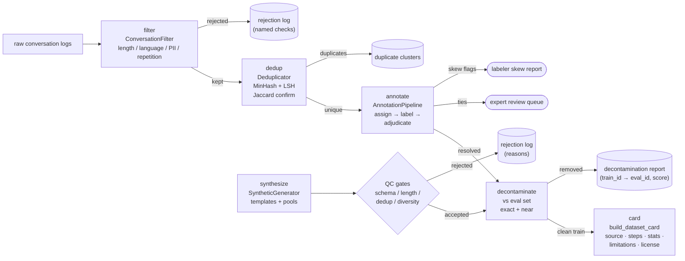
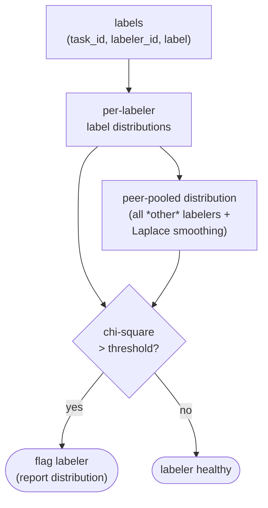

# Architecture

## Pipeline flow

## Skew detection

## Design rules

- **Deterministic**: seeded RNG (synthesis), seeded md5 MinHash (dedup),
  rotating assignment (annotation). Same inputs → same outputs, always.
- **Cited**: labels cite `(task_id, labeler_id)`; decontamination removals
  cite `(train_id → eval_id, score)`; rejections cite reasons.
- **Stdlib only**: no numpy, no sklearn — every algorithm is hand-rolled and
  readable, which is the point for an engineering portfolio.
- **Gates, not filters**: nothing is silently dropped. Every rejection path
  produces a log entry with a reason.
